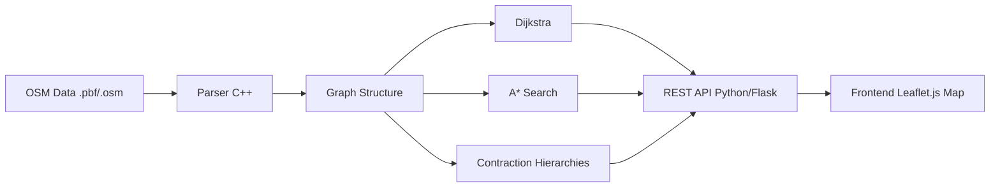

# 🗺️ Route Optimizer / Navigation Engine — Build Roadmap

> **Goal:** Build a Google Maps-like shortest path engine from scratch using real-world road data.
> **Stack:** C++ (core engine) + Python (API layer) + HTML/JS with Leaflet (frontend)
> **Time:** ~1-2 weeks

---

## 📐 Architecture Overview



### What You're Building

```
route-optimizer/
├── data/                    # OSM data files
│   └── city.osm             # Raw OpenStreetMap data
├── src/                     # C++ core engine
│   ├── parser/              # OSM XML parser
│   │   ├── osm_parser.h
│   │   └── osm_parser.cpp
│   ├── graph/               # Graph data structure
│   │   ├── graph.h
│   │   └── graph.cpp
│   ├── algorithms/          # Pathfinding algorithms
│   │   ├── dijkstra.h
│   │   ├── dijkstra.cpp
│   │   ├── astar.h
│   │   ├── astar.cpp
│   │   ├── contraction.h
│   │   └── contraction.cpp
│   ├── server/              # HTTP endpoint (or use Python)
│   │   └── api.cpp
│   └── main.cpp
├── api/                     # Python Flask API (simpler option)
│   └── server.py
├── frontend/                # Web visualization
│   ├── index.html
│   ├── style.css
│   └── app.js
├── CMakeLists.txt
└── README.md
```

---

## Phase 1: Understand the Data (Day 1)

### 🎯 Goal
Understand what OpenStreetMap data looks like and how roads are represented.

### 📚 Concepts to Learn
- **OSM Nodes**: Points on the map with `(latitude, longitude)` and a unique `id`
- **OSM Ways**: Ordered list of node IDs that form a road/path
- **OSM Tags**: Metadata on ways like `highway=residential`, `maxspeed=60`, `oneway=yes`

### 🔨 What to Do

1. **Go to [BBBike Extract](https://extract.bbbike.org/)** or **[Geofabrik](https://download.geofabrik.de/)**
   - Download a **small city extract** in `.osm` (XML) format
   - Start with something small like a single city (e.g., your hometown or a small town)
   - **Don't download an entire country** — start tiny!

2. **Open the `.osm` file** in a text editor and study the structure:

```xml
<!-- A NODE — a point on Earth -->
<node id="123456" lat="20.2961" lon="85.8245"/>

<!-- A WAY — a road made of nodes -->
<way id="789012">
    <nd ref="123456"/>   <!-- road passes through this node -->
    <nd ref="123457"/>
    <nd ref="123458"/>
    <tag k="highway" v="residential"/>   <!-- type of road -->
    <tag k="maxspeed" v="40"/>           <!-- speed limit -->
    <tag k="oneway" v="yes"/>            <!-- one-way street -->
</way>
```

3. **Key insight for graph building:**
   - Each `<node>` = a **vertex** in your graph
   - Each consecutive pair of `<nd>` refs in a `<way>` = an **edge**
   - Edge weight = **distance** between two nodes (calculated from lat/lon)

### ✅ Checkpoint
- [ ] Downloaded a small city `.osm` file
- [ ] Can identify nodes, ways, and tags in the XML
- [ ] Understand how roads map to graph edges

---

## Phase 2: Parse OSM Data & Build the Graph (Day 2-3)

### 🎯 Goal
Parse the `.osm` XML file and construct an adjacency list graph in C++.

### 📚 Concepts to Learn

**Haversine Formula** — Calculate real-world distance between two lat/lon points:

```
a = sin²(Δlat/2) + cos(lat1) * cos(lat2) * sin²(Δlon/2)
distance = 2 * R * atan2(√a, √(1-a))
where R = 6371 km (Earth's radius)
```

You already know this math — it's just a formula.

### 🔨 What to Do

#### Step 2.1: Define Data Structures

Think about what you need:

```
Node:
  - id (long long)
  - latitude (double)
  - longitude (double)

Edge:
  - target node id
  - weight (distance in meters, or time in seconds)

Graph:
  - Map from node_id → list of edges (adjacency list)
  - Map from node_id → Node (for coordinates)
```

> **Hint:** Use `unordered_map` for O(1) lookups. OSM node IDs can be very large numbers.

#### Step 2.2: Parse the XML

Options for XML parsing in C++:
- **RapidXML** (header-only, fast, easy) ← recommended
- **PugiXML** (also great, slightly nicer API)
- **TinyXML2**

Parsing logic:
```
1. First pass: Read all <node> elements → store id, lat, lon
2. Second pass: Read all <way> elements
   a. Check if tags contain "highway" (skip non-road ways)
   b. For each consecutive pair of <nd> refs:
      - Calculate distance using Haversine
      - Add edge (nodeA → nodeB, weight=distance)
      - If NOT oneway: also add edge (nodeB → nodeA)
```

> **Important Filter:** Not all ways are roads! Only process ways where `tag[highway]` exists.
> Skip values like `highway=footway`, `highway=cycleway` if you only want drivable roads.

#### Step 2.3: Highway Type → Speed Mapping

For **time-based** routing (more realistic than distance):

| Highway Type | Approx Speed (km/h) |
|---|---|
| motorway | 110 |
| trunk | 90 |
| primary | 70 |
| secondary | 50 |
| tertiary | 40 |
| residential | 30 |
| unclassified | 30 |

Edge weight = distance / speed = time

#### Step 2.4: Graph Statistics

After building, print stats to verify:
- Total nodes loaded
- Total nodes that are part of roads (will be much less)
- Total edges
- Is the graph connected? (Run a BFS/DFS from any node)

> **Pro tip:** Many nodes won't be part of any road. Only keep nodes that appear in at least one way. This dramatically reduces memory.

### ✅ Checkpoint
- [ ] XML parser reads nodes and ways correctly
- [ ] Graph is built as adjacency list
- [ ] Haversine distance calculation works (test with known coordinates)
- [ ] Graph stats look reasonable (e.g., a small city might have 50K-200K nodes, 100K-500K edges)
- [ ] Cleaned up: only road nodes are stored

---

## Phase 3: Implement Dijkstra's Algorithm (Day 3-4)

### 🎯 Goal
Find the shortest path between any two nodes in your road graph.

### 📚 You Already Know This!
As a CP guy, you've implemented Dijkstra many times. The only difference here:
- The graph is **huge** (100K+ nodes)
- Node IDs are `long long` (not 1-indexed integers)
- You need to **reconstruct the path**, not just find the distance

### 🔨 What to Do

#### Step 3.1: Core Dijkstra

```
Input: source node ID, target node ID
Output: shortest distance + list of node IDs forming the path

Algorithm (you know this):
1. Priority queue: (distance, node_id) — min-heap
2. dist[] map initialized to INF
3. parent[] map to reconstruct path
4. Standard relaxation loop
5. EARLY TERMINATION: Stop when you pop the target node!
```

> **Key optimization:** Early termination! In CP you often run Dijkstra to all nodes, but here you STOP as soon as you dequeue the destination. This is crucial for performance.

#### Step 3.2: Path Reconstruction

```
After Dijkstra terminates:
1. Trace back from target using parent[] map
2. Reverse the list → you have the path as a sequence of node IDs
3. Convert node IDs → list of (lat, lon) pairs for visualization
```

#### Step 3.3: Performance Measurement

Add timing:
- Time to run Dijkstra
- Number of nodes visited/relaxed
- Path distance (km) and estimated travel time

You'll use these numbers later to compare against A* and CH.

#### Step 3.4: Test It!

- Pick two nodes you know are connected (e.g., two major intersections)
- Verify the distance makes sense (compare with Google Maps)
- Test edge cases: same source and destination, unreachable nodes

### ✅ Checkpoint
- [ ] Dijkstra finds shortest path on your city graph
- [ ] Path reconstruction works
- [ ] Results are reasonable (compare a few routes with Google Maps)
- [ ] Performance: note the time and nodes visited

---

## Phase 4: Implement A* Search (Day 4-5)

### 🎯 Goal
Speed up pathfinding using the A* heuristic.

### 📚 The Key Idea

A* is Dijkstra + a **heuristic** that guides the search toward the target.

```
Instead of:  priority = distance_so_far
Use:         priority = distance_so_far + heuristic(current, target)
```

The heuristic = **straight-line distance** (Haversine) from current node to target.

This is **admissible** (never overestimates) because straight-line ≤ road distance. So A* is guaranteed to find the optimal path!

### 🔨 What to Do

#### Step 4.1: Implement A*

The code is almost identical to Dijkstra. Changes:

```
1. Priority queue now uses: (g[node] + h(node, target), node_id)
   where g[node] = actual distance from source
         h(node, target) = haversine(node, target)  ← the heuristic

2. When relaxing edges, still use actual distances for g[]
3. Only the PRIORITY changes (not the distance tracking)
```

> **Common bug:** Make sure you use `g[node]` (actual cost) for relaxation, not `f[node]` (cost + heuristic). The heuristic only affects the priority queue ordering.

#### Step 4.2: Compare with Dijkstra

Run both on the **same queries** and compare:

| Metric | Dijkstra | A* |
|---|---|---|
| Nodes visited | ? | ? (should be much less) |
| Time (ms) | ? | ? (should be faster) |
| Path distance | X km | X km (must be identical!) |

> **If the distances differ, you have a bug!** A* with admissible heuristic must find the same optimal path.

#### Step 4.3: Visualize the Search Space (Optional but Cool)

Store all visited nodes during search. Later on the frontend, you can render:
- **Dijkstra's visited nodes** → expands in a circle (explores everywhere)
- **A*'s visited nodes** → expands in an ellipse toward the target (focused)

This makes for an **amazing** demo/README screenshot.

### ✅ Checkpoint
- [ ] A* finds the same shortest path as Dijkstra
- [ ] A* visits significantly fewer nodes
- [ ] A* is measurably faster
- [ ] You understand why the heuristic must be admissible

---

## Phase 5: Contraction Hierarchies (Day 6-8)

### 🎯 Goal
Implement the algorithm that actually powers Google Maps / OSRM for instant routing.

### 📚 The Big Idea

Dijkstra/A* are still too slow for country-scale graphs (millions of nodes). **Contraction Hierarchies (CH)** solve this with:

1. **Preprocessing** (one-time, expensive): Create "shortcut" edges
2. **Query** (super fast): Bidirectional search using shortcuts

Think of it like: instead of navigating through every small street, you precompute "if you enter this neighborhood at point A, the fastest way out is through point B, taking 5 minutes." Then during queries, you skip the neighborhood entirely.

### 🔨 What to Do

#### Step 5.1: Understand Node Ordering

- Assign an **importance** to each node
- Less important nodes get "contracted" first
- Important nodes (highway intersections) stay
- Simple heuristic for importance: `edge_difference = shortcuts_needed - edges_removed`

#### Step 5.2: Node Contraction

To contract node `v`:
```
1. For each pair of neighbors (u, w) of v:
   - Check if the shortest path u→w goes through v
   - If yes: add a SHORTCUT edge u→w with weight = w(u,v) + w(v,w)
2. Remove v from the graph (mark as contracted)
3. Record the contraction order (this becomes the "level" of each node)
```

> **Witness search:** To check if u→w must go through v, run a local Dijkstra from u (limited hops/distance). If you find a path u→w that doesn't use v and is ≤ w(u,v)+w(v,w), no shortcut needed.

#### Step 5.3: Bidirectional Query

After preprocessing, queries are blazing fast:

```
1. Forward search: Dijkstra from source, only going UPWARD in node order
2. Backward search: Dijkstra from target, only going UPWARD in node order
3. Both searches meet somewhere in the "middle" (high-importance nodes)
4. Shortest path = min over all nodes v of (forward_dist[v] + backward_dist[v])
```

#### Step 5.4: Path Unpacking

The path from CH contains shortcut edges. You need to recursively unpack them:
```
To unpack shortcut (u → w):
  Find the contracted node v that created this shortcut
  Recursively unpack (u → v) and (v → w)
```

### Complexity

| | Dijkstra | A* | CH |
|---|---|---|---|
| Preprocessing | None | None | O(n log n) — minutes |
| Query Time | O((V+E) log V) | Faster in practice | **< 1ms** typically |
| Space | O(V+E) | O(V+E) | O(V+E+shortcuts) |

> **This is the hardest part of the project.** Take your time. If you get CH working, you're ahead of 99% of applicants.

> **Fallback:** If CH is too complex, skip it and mention it as "future work" in your README. Dijkstra + A* is already impressive.

### ✅ Checkpoint
- [ ] Node ordering/contraction works on a small test graph first
- [ ] Shortcut edges are created correctly
- [ ] Bidirectional query finds the same shortest path as Dijkstra
- [ ] Query time is dramatically faster (< 1ms vs hundreds of ms)
- [ ] Path unpacking returns the full sequence of original nodes

---

## Phase 6: Build the API Layer (Day 9-10)

### 🎯 Goal
Expose your C++ engine as a REST API so the frontend can call it.

### 📚 Two Options

**Option A: Python wrapper (easier, recommended)**
- Compile your C++ engine as a CLI tool
- Python Flask/FastAPI calls it as a subprocess
- Parse the output

**Option B: C++ HTTP server**
- Use a library like `httplib` (header-only) or `crow`
- Serve directly from C++

### 🔨 What to Do (Option A — Python Wrapper)

#### Step 6.1: Make C++ a CLI Tool

Your `main.cpp` should accept command-line args:

```bash
./route_engine --source-lat 20.29 --source-lon 85.82 \
               --target-lat 20.31 --target-lon 85.85 \
               --algorithm astar
```

Output as JSON:
```json
{
  "distance_km": 3.45,
  "time_minutes": 6.2,
  "nodes_visited": 1234,
  "query_time_ms": 12.5,
  "path": [
    [20.2961, 85.8245],
    [20.2975, 85.8260],
    ...
  ]
}
```

> **Nearest node:** The user clicks on a map (any lat/lon). You need to find the **nearest graph node** to that point. Use a simple linear scan for now, or build a KD-tree for O(log n) lookups.

#### Step 6.2: Python API Server

```python
# Endpoints to build:

GET /api/route?src_lat=...&src_lon=...&dst_lat=...&dst_lon=...&algo=dijkstra
→ Returns: path coordinates, distance, time, stats

GET /api/algorithms
→ Returns: list of available algorithms

GET /api/bounds
→ Returns: map bounding box (min/max lat/lon of your data)
```

### ✅ Checkpoint
- [ ] C++ CLI takes coordinates and outputs JSON
- [ ] Python API calls C++ and returns results
- [ ] API handles errors gracefully (invalid coords, unreachable nodes)
- [ ] Response time is acceptable

---

## Phase 7: Frontend Visualization (Day 10-12)

### 🎯 Goal
Build a web UI where you click two points on a map and see the route.

### 📚 Tools
- **Leaflet.js** — Lightweight map library (open source, uses OSM tiles)
- Vanilla HTML/CSS/JS — keep it simple

### 🔨 What to Do

#### Step 7.1: Basic Map

```
1. Create an HTML page with a Leaflet map
2. Center on your city (use the bounds from your API)
3. Add OpenStreetMap tile layer (free, no API key needed)
```

#### Step 7.2: Click-to-Route

```
User interaction flow:
1. First click → place a GREEN marker (source)
2. Second click → place a RED marker (destination)
3. Automatically call your API with coordinates
4. Draw the returned path as a colored polyline on the map
5. Show stats in a sidebar (distance, time, nodes visited, query time)
6. Next click → clear and start over
```

#### Step 7.3: Algorithm Comparison Panel

This is what makes your project **stand out**:

```
- Dropdown to select algorithm (Dijkstra / A* / CH)
- "Compare All" button → runs all 3, shows results side by side:

  ┌──────────────────────────────────────────────────┐
  │  Algorithm  │ Distance │  Time  │ Nodes │ Query  │
  │─────────────│──────────│────────│───────│────────│
  │  Dijkstra   │  3.45 km │ 6.2 m  │ 45231 │ 125ms  │
  │  A*         │  3.45 km │ 6.2 m  │ 12045 │  42ms  │
  │  CH         │  3.45 km │ 6.2 m  │   312 │  0.8ms │
  └──────────────────────────────────────────────────┘
```

#### Step 7.4: Visualize Search Space (The WOW Factor 🤯)

Remember the visited nodes you stored? Render them:
- Dijkstra: big blue circle expanding outward
- A*: focused ellipse toward target
- CH: tiny dots near source and target

This single visualization will make interviewers go **"whoa"**.

#### Step 7.5: Polish
- Dark mode map tiles (use CartoDB dark tiles)
- Animated path drawing
- Responsive sidebar with stats
- Loading spinner during route calculation

### ✅ Checkpoint
- [ ] Map loads and centers on your city
- [ ] Click two points → route appears on map
- [ ] Algorithm comparison works
- [ ] Search space visualization works
- [ ] UI looks polished and professional

---

## 🏁 Final Polish & README (Day 13-14)

### README Must Include:
1. **Demo GIF/Screenshot** — show the map with a route and comparison table
2. **Architecture diagram** — the mermaid diagram from above
3. **How it works** — brief explanation of each algorithm
4. **Performance benchmarks** — table comparing algorithms on your data
5. **How to run** — clear setup instructions
6. **Data source** — credit OpenStreetMap

### Resume Line:

> *"Built a navigation engine from scratch processing 200K+ road intersections from OpenStreetMap. Implemented Dijkstra, A*, and Contraction Hierarchies — achieving sub-millisecond query times on city-scale graphs. Includes interactive map visualization comparing algorithm search spaces."*

---

## 📋 Day-by-Day Schedule

| Day | Phase | What You're Doing |
|---|---|---|
| 1 | Phase 1 | Download data, study OSM format |
| 2-3 | Phase 2 | Build XML parser, construct graph |
| 3-4 | Phase 3 | Implement Dijkstra, verify paths |
| 4-5 | Phase 4 | Implement A*, compare performance |
| 6-8 | Phase 5 | Contraction Hierarchies (hard!) |
| 9-10 | Phase 6 | CLI tool + REST API |
| 10-12 | Phase 7 | Leaflet frontend + visualization |
| 13-14 | Polish | README, benchmarks, demo GIF |

---

## 📖 Resources

| Topic | Resource |
|---|---|
| OSM Data Format | [OSM Wiki: Elements](https://wiki.openstreetmap.org/wiki/Elements) |
| Small City Data | [BBBike Extract](https://extract.bbbike.org/) |
| Haversine Formula | [Wikipedia](https://en.wikipedia.org/wiki/Haversine_formula) |
| RapidXML | [GitHub](https://github.com/dwd/rapidxml) |
| Contraction Hierarchies | [Original Paper by Geisberger et al.](https://algo2.iti.kit.edu/schultes/hwy/contract.pdf) |
| CH Explained Simply | [YouTube: Contraction Hierarchies](https://www.youtube.com/watch?v=2VwDJUaJJTg) |
| Leaflet.js | [leafletjs.com](https://leafletjs.com/) |
| Dark Map Tiles | `https://{s}.basemaps.cartocdn.com/dark_all/{z}/{x}/{y}{r}.png` |

---

> [!TIP]
> **Start small.** Get Dijkstra working on a tiny graph (10 nodes) before touching real OSM data. Build up layer by layer. Your CP instincts will carry you through the algorithms — the new skill here is systems engineering: parsing real data, building APIs, and creating a visual product.

> [!IMPORTANT]
> **Don't skip the visualization.** A working algorithm with no visual output is hard to demo. The map visualization is what makes recruiters and interviewers go "wow." It's also what makes this a **project** and not just a **homework assignment**.
